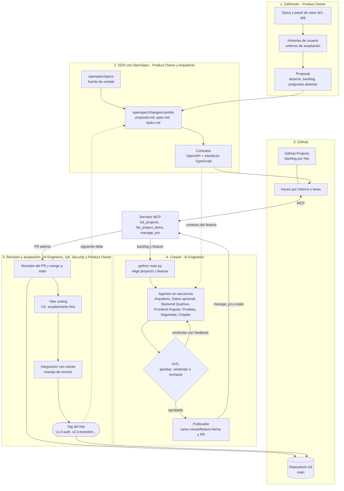
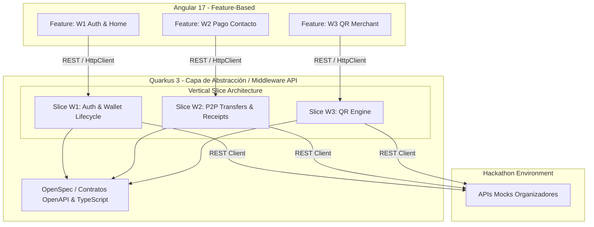
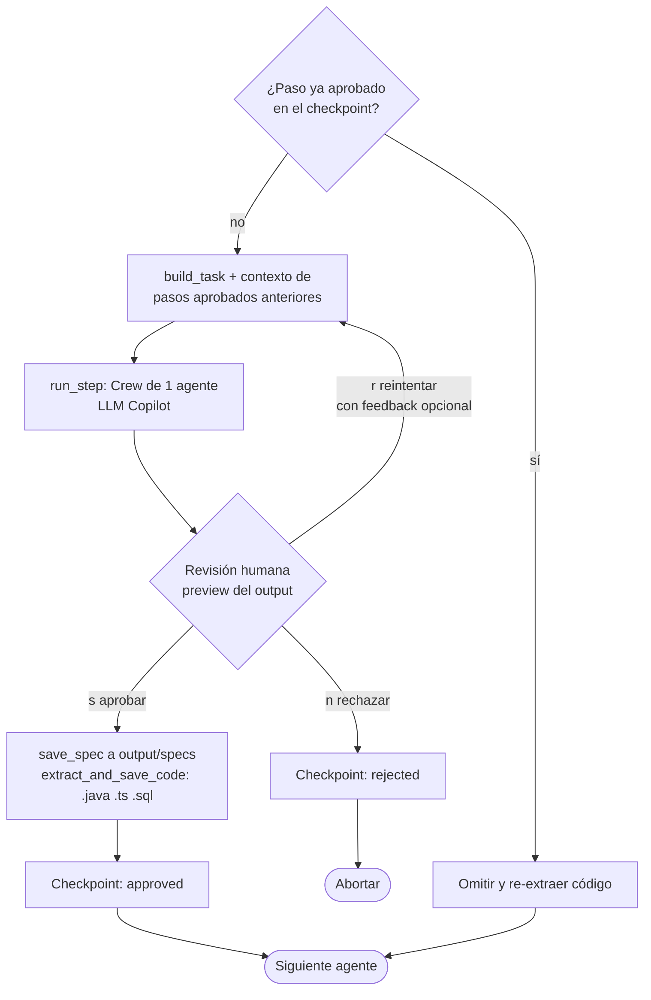

# Wallet Ayni

Billetera digital web para Perú (dinero ficticio, identidades sintéticas) construida en una
**hackathon de 6 horas por un equipo multidisciplinario**. El objetivo es demostrar ingeniería de
software de alto nivel: **Spec-Driven Development (SDD) con OpenSpec**, tripulaciones de agentes
**CrewAI**, comunicación vía **MCP** y una arquitectura modular escalable.

## Contenido

1. [Estado](#estado)
2. [Metodología y principios](#metodología-y-principios)
3. [Equipo y roles](#equipo-y-roles)
4. [Roadmap de hitos](#roadmap-de-hitos)
5. [Historia activa: confirmación de pagos de bajo monto](#historia-activa-confirmación-de-pagos-de-bajo-monto)
6. [Diagramas](#diagramas)
7. [Estructura del repositorio](#estructura-del-repositorio)
8. [Flujo de trabajo Git](#flujo-de-trabajo-git)
9. [Puesta en marcha](#puesta-en-marcha)
10. [Definición de terminado](#definición-de-terminado)
11. [Decisiones abiertas y riesgos](#decisiones-abiertas-y-riesgos)

## Estado

| Área | Estado |
| --- | --- |
| Estrategia y roles | Definidos (este documento) |
| Specs OpenSpec (`openspec/`) | Pendiente: `openspec init` (Product Owner y Arquitecto) |
| Backend (`src/backend/`) | Pendiente |
| Frontend (`src/frontend/`) | Pendiente |
| Tripulación CrewAI | Pendiente |
| Tags de versión | Ninguno todavía |

## Metodología y principios

### Spec-Driven Development con OpenSpec

- **Fuente de verdad:** toda funcionalidad se especifica primero en `openspec/specs/`; no se escribe código sin spec.
- **Cambios incrementales (deltas):** cada historia vive en `openspec/changes/<nombre-cambio>/` con `proposal.md`, `spec.md` y un `tasks.md` granular. No se reescribe el repositorio.
- **Contratos:** los contratos OpenAPI y las interfaces TypeScript definidos en OpenSpec son el contrato inalterable entre frontend y backend.

### Arquitectura de código

| Capa | Decisión |
| --- | --- |
| Backend | Quarkus 3 con Vertical Slice Architecture: `src/backend/core/w1-auth/`, `w2-transfers/`, etc. Módulos independientes, sin colisiones de archivos. |
| Frontend | Angular 17 por features: `src/frontend/features/wallet-onboarding/`, `p2p-transfer/`, etc. |
| Middleware | Capa de abstracción aislada entre la UI y las APIs mock de la hackathon; normaliza contratos y errores. |

### Estrategia híbrida de IA

- **CrewAI (trabajo pesado):** agentes locales leen las GitHub Issues (sincronizadas desde OpenSpec vía MCP) y generan la capa de abstracción, la lógica financiera y los esquemas.
- **Vibe coding humano (pulido y UX):** el equipo, con Copilot, consume la salida de CrewAI, da el acabado visual, resuelve el acoplamiento fino y valida la experiencia.

## Equipo y roles

### Product Owner

- Priorizar ambas historias y definir el alcance y el resultado esperado.
- Establecer el umbral de bajo monto y resolver reglas de negocio pendientes.
- Mantener criterios de aceptación claros y aprobar los escenarios funcionales.
- Aclarar dudas de negocio y aceptar o rechazar el resultado entregado.

### Arquitecto

- Definir los módulos involucrados, sus responsabilidades y dependencias.
- Acordar contratos, mocks, permisos y decisiones técnicas con el equipo.
- Evaluar riesgos de duplicidad, errores y consistencia en el flujo de pagos.
- Asegurar que la solución respete los criterios aprobados y los componentes existentes.

### AI Engineer (2)

- Implementar incrementos pequeños y trazables dentro del alcance aprobado.
- Usar los mocks y contratos acordados, sin inventar reglas de negocio.
- Revisar cada diferencia generada con IA antes de integrarla.
- Añadir o actualizar pruebas y comunicar bloqueos, riesgos y decisiones pendientes.

### QA

- Convertir los criterios aprobados en escenarios de prueba verificables.
- Probar los casos normales, límites y errores de ambos flujos.
- Verificar que la consulta respete los permisos definidos.
- Registrar resultados, evidencia y defectos; confirmar las correcciones.

### Security

- Revisar autorización y acceso a la información financiera.
- Evaluar riesgos de exposición de datos y de repetición o duplicación de pagos.
- Recomendar controles proporcionales al flujo y verificar su aplicación.
- Confirmar que las pruebas no revelen datos sensibles en respuestas o registros.

### Colaboración y puntos de contacto

- Todos los roles colaboran entre sí.
- Puntos de contacto: por definir.

## Roadmap de hitos

| Hito | Ventana | Tag | Alcance |
| --- | --- | --- | --- |
| 1 | Hora 1–2 | `v1.0-auth` | **W1** Registro y activación: creación de wallet, estados de riesgo (aprobación, rechazo, revisión) y Home con saldo inicial. |
| 2 | Hora 3–4 | `v2.0-transfers` | **W2** Pago a contacto: selección de destinatario, pago P2P y resultado terminal. Comprobante e historial quedan en backlog de la HU activa. |
| 3 | Hora 4–5 | `v3.0-merchant` | **W3** Pago QR a comercio: generación y resolución de QR (monto fijo o abierto). |
| 4 | Hora 5–6 | `v4.0-resilience` | **W4** Idempotencia y callbacks, **W5** fallas y reversos, **W6** conciliación. |

La hora 2–3 es de integración y estabilización del Hito 1 antes de abrir W2.

## Historia activa: confirmación de pagos de bajo monto

Como pagador, quiero completar una transferencia de bajo monto y recibir una confirmación
definitiva del resultado, para confiar en si el pago se realizó o no. Corresponde al Hito 2 (W2).

### Flujo de pantallas

| Pantalla | Contenido |
| --- | --- |
| T1 Home | Saludo, saldo (`GET /wallets/{id}`) y acción principal grande **Nuevo pago**. |
| T2 Contacto | Lista con nombre, alias enmascarado y búsqueda simple sobre un mock local que mapea a `contact-demo` y `merchant-demo`. |
| T3 Datos del pago | Origen `wallet-demo` (solo lectura), destino elegido y monto en soles con teclado numérico (se envía en céntimos). |
| T4 Confirmación | Resumen simple ("Vas a pagar S/ 15.00 a Juan Pérez") con **Confirmar** y **Corregir**. |
| T5 Resultado | Estado intermedio "Procesando" y un único estado terminal (Exitoso, Fallido o Expirado) con referencia (`id` del pago), fecha, destino y monto. Acción **Volver al inicio**. |

### Reglas clave

- **Bajo monto:** entre S/ 10 y S/ 1000, validado en la app y en el servidor. El campo de captura no acepta menos de S/ 0.01.
- **Sin doble envío:** el botón Confirmar se bloquea mientras se procesa.
- **Idempotency-Key:** obligatorio en cada `POST /payments` (1–200 caracteres, único por wallet); la app lo genera para el único intento. Su reutilización en reintentos queda en backlog.
- **Normalización de campos:** el cuerpo de `POST /payments` usa camelCase (`walletId`, `amountCents`) y las respuestas usan snake_case (`wallet_id`, `amount`); la capa de integración los mapea.
- **Catálogo de mensajes** centralizado y editable: las etiquetas finales están pendientes con producto.

### Mapeo de respuestas del backend

| Respuesta | Comportamiento en la app |
| --- | --- |
| `202 PENDING` | Mostrar "Procesando" y hacer polling de `GET /payments/{id}` hasta estado terminal. |
| Tiempo máximo de la app agotado | Resultado **Expirado**. |
| `409 INSUFFICIENT_FUNDS`, `409 WALLET_NOT_ACTIVE`, `400`, `404`, `413`, `429` | Fallo claro, antes o durante el envío. |
| `503 PROVIDER_ERROR` | **Fallido**: el backend confirma que no se creó operación ni reserva. |
| `504 TIMEOUT_AFTER_PROCESSING` | No mostrar Expirado ni Fallido: el pago ya existe; continuar el polling y reflejar el estado real. |

### Inclusión y accesibilidad (transversal)

Texto ≥ 18 px y contraste WCAG AA, botones ≥ 48 px, un objetivo por pantalla, lenguaje sin jerga
("Tu pago se hizo", "No se hizo el pago, tu dinero está a salvo"), íconos siempre con texto, ayuda
visible ("¿Necesitas ayuda?"), compatibilidad con lector de pantalla y estado "En proceso"
tranquilizador que no pierde el intento si se cierra la app.

### Escenarios de prueba del mock

`APPROVED`, `REJECTED`, `PENDING`, `DELAYED_APPROVAL`, `TIMEOUT_AFTER_PROCESSING`, `PROVIDER_ERROR`,
saldo insuficiente y doble toque. Los endpoints `POST /callbacks/payments`, `POST /control/provider/{id}/complete` y
`GET /control/events` son solo herramientas de prueba del mock, no parte del flujo de la app.

### Fuera de alcance de esta historia (backlog)

- Reintentos y reutilización de `Idempotency-Key` (`409 IDEMPOTENCY_CONFLICT`): Hito 4.
- Flujo con `qrId` (`410 QR_EXPIRED`, `409 QR_PAYMENT_MISMATCH`): Hito 3.
- Historial (`GET /payments?walletId=`) y comprobante (`GET /payments/{id}/receipt`).
- Instrumentación de checkout (`checkout_started`, `payment_confirmed`, `payment_result`, `checkout_abandoned`).
- Gestión real de contactos y copy final de los mensajes.

## Diagramas

Se mantienen solo los diagramas indispensables: la arquitectura agéntica de extremo a extremo (cómo se
produce el software), la arquitectura técnica (qué se construye) y el detalle de la orquestación CrewAI
(flujo general y ciclo de aprobación por agente).

### Arquitectura agéntica de extremo a extremo

De la definición de las HU hasta el tag del hito. Cada etapa indica el rol responsable.



### Arquitectura Software



### Orquestación de agentes CrewAI

Recorrido completo de `python main.py`: backlog por MCP, agentes con aprobación humana (HITL) y
publicación de la fuente generada en un Pull Request.

#### Flujo general

```mermaid
flowchart TD
    A([python main.py]) --> B[MCP Proyectos :8081<br/>tools/list + autenticación]
    B --> C[list_projects: elegir proyecto]
    C --> D[list_project_items: elegir feature del backlog]
    D --> E[get_feature_from_item<br/>título, descripción, criterios de aceptación]
    E --> F{¿Checkpoint en<br/>output/.checkpoint.json?}
    F -- otro feature --> F1{¿Empezar de cero?}
    F1 -- no --> X([Fin])
    F1 -- sí --> G
    F -- mismo feature o ninguno --> G[Cargar pasos aprobados<br/>+ ensure_scaffolding]
    G --> H[Enriquecer Arquitecto con<br/>HEX_PROMPT_PREFIX + brief del feature]
    H --> S1

    subgraph LOOP [Un mini-Crew por agente, en secuencia]
        direction TB
        S1[1. Arquitecto] --> S1D{{Datos y persistencia<br/>solo si CREWAI_INCLUDE_DATA=true}}
        S1D --> S2[2. Backend Quarkus]
        S2 --> S3[3. Frontend Angular]
        S3 --> S4[4. Pruebas]
        S4 --> S5[5. Seguridad]
        S5 --> S6[6. Chapter<br/>revisor final]
    end

    S6 --> V[Veredicto del Chapter]
    V --> Q{¿PUBLISH_ENABLED<br/>y hay archivos?}
    Q -- no --> Z([Fin])
    Q -- sí --> R{¿Crear rama y PR? s/n}
    R -- n --> Z
    R -- s --> W[Agente Publicador<br/>redacta título y cuerpo del PR]
    W --> W1{¿Chapter APROBADO?}
    W1 -- sí --> Y[draft = false]
    W1 -- no --> Y2[draft = true]
    Y --> G1
    Y2 --> G1
    G1[git clone temporal de<br/>GITHUB_OWNER/GITHUB_REPO] --> G2[checkout -b crewai/feature-fecha<br/>copiar output/ a source/<br/>commit + push]
    G2 --> M[MCP local :8081<br/>manage_prs action=create<br/>head=rama nueva, base=main]
    M --> PR([PR abierto en ai-labs])
```



#### Detalle de cada paso de agente (HITL + checkpoint)



#### Referencias del proyecto CrewAI

Los archivos viven en el repositorio del orquestador CrewAI, no en este.

| Pieza | Archivo |
| --- | --- |
| Orquestación y HITL | `main.py` |
| Orden de agentes | `crew/workflow.py` |
| Cliente MCP de proyectos | `mcp_projects.py` |
| Agente Publicador | `agents/publisher.py` |
| Rama, push y PR | `publish.py` |

## Estructura del repositorio

```text
wallet-ayni-hackathon/
├── openspec/
│   ├── specs/                    # fuente de verdad
│   └── changes/<cambio>/         # proposal.md, spec.md, tasks.md
├── src/
│   ├── backend/core/             # w1-auth/, w2-transfers/, ... (vertical slices)
│   └── frontend/features/        # wallet-onboarding/, p2p-transfer/, ...
├── architecture/                 # decisiones y diagramas
└── docs/                         # historias y notas de producto
```

La estructura es la objetivo; se crea a medida que avanzan los hitos.

## Flujo de trabajo Git

1. El Product Owner y el Arquitecto abren el delta en `openspec/changes/<cambio>/` y sincronizan sus tareas a Issues.
2. CrewAI trabaja en una rama `crewai/<feature>-<fecha>` y abre un PR por feature.
3. Revisión humana y merge a `main`; el frontend se pule sobre `main` con vibe coding.
4. QA valida contra los mocks y Security revisa los controles; el Product Owner acepta o rechaza, y un AI Engineer crea el tag del hito (`v1.0-auth`, `v2.0-transfers`, `v3.0-merchant`, `v4.0-resilience`).

Los agentes no hacen push a `main` ni crean tags.

## Puesta en marcha

Pendiente de construir. Pasos previstos:

- [ ] `openspec init` y spec de W1 (Product Owner y Arquitecto).
- [ ] Configurar el servidor MCP de GitHub y sincronizar Issues (Arquitecto).
- [ ] Definir la tripulación CrewAI y sus perfiles (AI Engineers).
- [ ] Esqueletos de `src/backend/` (Quarkus 3) y `src/frontend/` (Angular 17) (AI Engineers).
- [ ] Capa de abstracción contra las APIs mock (AI Engineers, con QA y Security).

Los comandos de arranque se documentarán aquí cuando existan los esqueletos.

## Definición de terminado

Un hito está terminado cuando:

- La spec y su `tasks.md` están completas y trazables a los criterios de aceptación.
- El código cumple los schemas del contrato sin modificarlos.
- Se probaron los escenarios del mock aplicables y los casos de error.
- El PR fue revisado por una persona y fusionado a `main`.
- Existe el tag del hito.

## Decisiones abiertas y riesgos

- **Stack unificado:** backend Quarkus 3.x (Java) y frontend Angular 17.
- **Límites de bajo monto** por proveedor/canal sin cerrar.
- **Etiquetas finales** de los estados terminales y del catálogo de mensajes.
- **Tiempo máximo** en "Procesando" antes de declarar "Expirado".
- **Riesgo de tiempo:** 6 horas para 4 hitos; si hay retraso, se recorta W5–W6 antes que W1–W2.
- **Riesgo de calidad de IA:** el código de CrewAI siempre pasa por PR y revisión humana.
